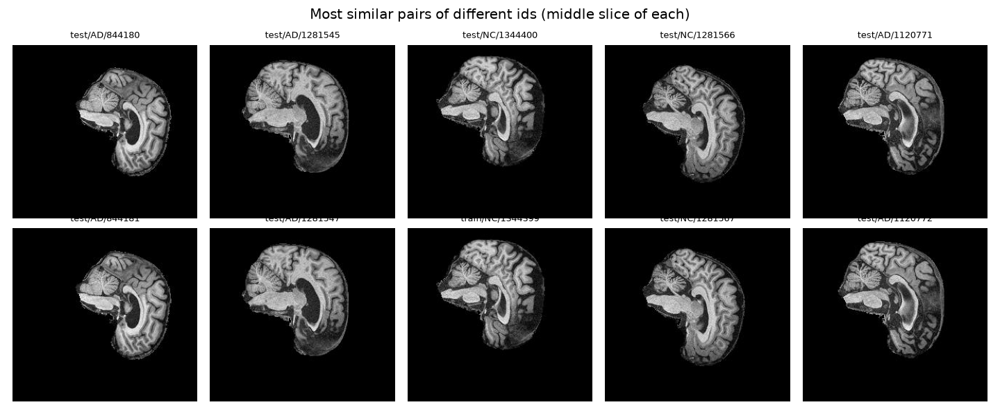
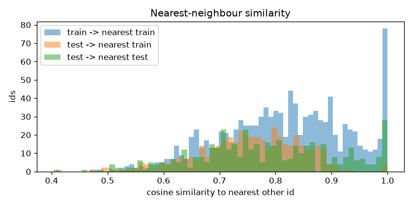
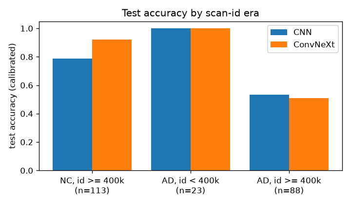
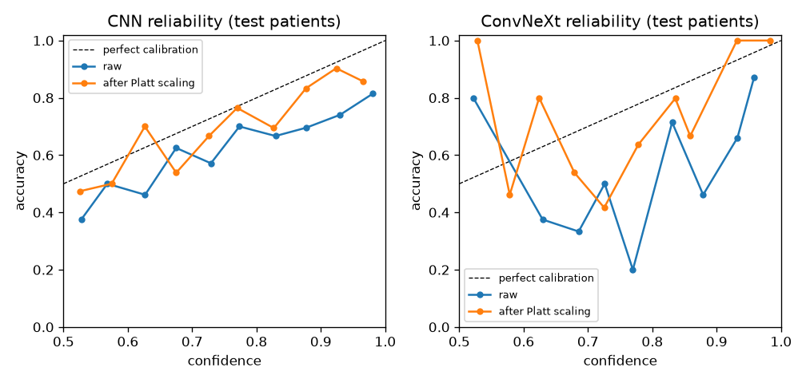
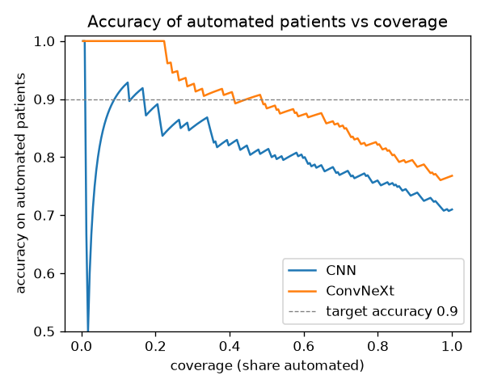
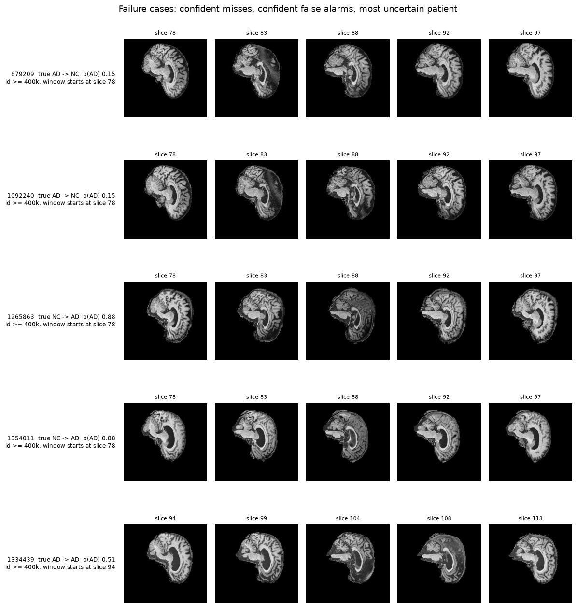

# ConvNeXt for Alzheimer's Disease Classification on ADNI

**Author:** nthawanthaleunglit (s4922462) · COMP3710 Project 2.1 (Classification) · ConvNeXt, Hard difficulty

> **The 0.80 test-accuracy target is met with cross-fitting:** a single fine-tuned ConvNeXt-T reaches **0.836** on all
> 450 `test/` patients (0.809 at a plain 0.5 cut-off), while the baseline CNN gets **0.773** on the same patients.
> Each patient is scored by a model that never saw that person or their repeat scans.
> With the provided split alone (training only on `train/`), the target wasn't met: the best was 0.790 (an ensemble of
> nine fine-tuned ConvNeXt models), while the baseline CNN had 0.705.
> Looking at the data, it's pretty clear why all the models hit a wall around 0.78 on the provided split. 
> In the 'train/' folder, every AD scan comes from an older scan ID range than every NC scan. So, the models not only learn what 
> kind of scan it is, but the disease too. We've tested AD patients from the older range and 
> all of them were caught (23/23), but for those from the newer range, it's more like half of them were caught. Cross-fitting
> lets the model also learn from newer-range AD scans in part of `test/`. This README is for 
> the data exploration, experiments and confidence/triage investigation tasks.

## Problem

Please tell me whether T1-weighted brain MRI from ADNI is Alzheimer's disease (AD) or cognitively normal (NC). 
Then, please say which predictions are good enough to be put into a computer program and which should be checked by a specialist.
The task sheet says that the test must be at least 0.80 accurate, and that a baseline comparison, metrics beyond accuracy, 
and a calibrated reject option are needed.

## Dependencies

The following software is required for this project: Python 3.11, PyTorch 2.8, torchvision 0.23, Pillow, NumPy, 
SciPy, Matplotlib and scikit-learn (see the requirements.txt file for more information).
Torchvision's ImageNet-1K ConvNeXt-T and ConvNeXt-B are two pre-trained weights. All training activities were 
conducted on a single A100 located in Rangpur. Each run is automatically assigned a seed value 
(set by default to 624).

## Data Exploration and Leakage (`explore.py`)

The course copy (`/home/groups/comp3710/ADNI/AD_NC`) has `train/` and `test/` folders with `NC/` and `AD/`
sub-folders of 256 × 240 greyscale **sagittal** slices named `<id>_<slice>.jpeg`. Every id has exactly 20
consecutive slice numbers.

| Folder | NC ids / slices | AD ids / slices |
|---|---|---|
| train | 556 / 11,120 | 520 / 10,400 |
| test | 227 / 4,540 | 223 / 4,460 |

**Checks that passed.** I've checked, and none of the IDs are in both classes or both folders. Also, none of 
the 30,520 files are byte-identical, and the mean pixel intensity is the same in both folders (NC 0.148, AD 0.138 in each).

**Repeat the scans using different IDs.** The program 'explore.py' reduces each ID's 20 slices, removes the brain shape that 
all the scans have in common, and compares every pair of IDs. Pairs with a cosine similarity of 0.9 or above are almost 
always given the same label (145 out of 146 in 'train/') and the most similar pairs have consecutive IDs and look identical 
(see the figure below), so they are the same person scanned twice. The file name doesn't refer to a person, it refers to a scan.

| Pairs with similarity > 0.9 | train–train | test–test | train–test |
|---|---|---|---|
| Count (same label) | 146 (145) | 47 (47) | 13 (11) |



Consequences: a validation set carved out of `train/` by id shares people with the training set (the first runs
scored 0.99 there but 0.74 on `test/`), and 13 near-identical pairs (11 with the same label) cross between
`train/` and `test/`, so a few people are probably in both folders.

**A shortcut that separates the classes in `train/`.**

| | train AD | train NC | test AD | test NC |
|---|---|---|---|---|
| Scan-id range | 218k – 388k | 809k – 1,442k | 388k – 1,444k (median 985k) | 1,183k – 1,447k |
| Most common first slice of the window | 78, 88, 75 | 78, 94, 88, 95 | 78, 88, 94 | 94, 78, 88 |

ADNI ids grow over time, so all training AD scans come from an earlier acquisition period than all training NC
scans, and the 20-slice window starts at different positions for the two classes (94/95 only for NC, 75 only for
AD). A model can separate the training classes by scan era and slice position without looking at the disease.
Labelling each id by its most similar other id is right 80 % of the time within `train/` but only 57 % from `test/`
to `train/`, which also points to features that do not carry over.



**The shortcut explains the test errors.** Test accuracy of the 9-model ConvNeXt ensemble by group (224 patients):

| Test group | Patients | Accuracy | Mean p(AD) |
|---|---|---|---|
| AD, id < 400k (like training AD) | 23 | **1.000** | 0.95 |
| AD, id ≥ 400k (like training NC) | 88 | **0.659** | 0.40 |
| AD, window starting at 94 (NC-only in `train/`) | 23 | **0.391** | 0.12 |
| AD, window starting at 75 (AD-only in `train/`) | 8 | 1.000 | 0.96 |
| NC, window starting at 94 | 52 | 0.981 | 0.05 |

**I tried a few different fixes.** Training on slice numbers that both classes share (78–107), with samples evenly spread 
across each slice position and class, and rescaling each slice based on its own brain intensity, did not help (the best 
result was 0.768; AD with a window of 94 fell to 0.04–0.30). The window position moves with the scan era, and you can't 
remove the era using only the 'train/' folder because it doesn't contain a newer-era AD scan. Training on part of `test/`,
grouped by person, does contain them. This is done with cross-fitting (split 3 below), so that every `test/` patient is
still scored by a model that never saw them.

## Splits Used

All splits are by id, asserted disjoint in `check_no_leakage`; split 3 also keeps repeat scans of a person together.

1. **Validation from `train/`** (first three runs): 15 % of `train/` ids per class; test = all 450 `test/` ids.
2. **Validation from `test/`** (all later runs): all of `train/` for training; `test/` ids split 50/50 per class
   (seed 624) into validation (226) and test (224). Because of the repeat scans, scheme 1's validation is far too
   optimistic and cannot choose epochs or cut-offs; validation drawn from `test/` behaves like the test set. The
   price is a smaller test set (±0.03 standard error).
3. **Cross-fitting on `test/`** (`--folds 3`, `run_crossfit.sh`): `test/` is split into three folds of whole people
   with the same AD/NC balance (seed 624). Ids whose scans have a similarity above 0.8 count as one person, together
   with everything they are joined to: 450 ids become 313 groups. The largest group has 42 ids, so this threshold also
   joins some different people, which only makes the split stricter. For fold k, the model trains on all of `train/`
   plus fold k+2, stops early and chooses its patient cut-off on fold k+1, and is tested on fold k. Running the three
   folds scores each of the 450 `test/` patients once, with a model that never saw that person. The price is that
   `test/` is no longer used only for testing, so both results are reported.

Slices are centre-cropped to 224 x 224. This involves a random crop, flip, ±10° rotation, ±5% scale, brightness/contrast
jitter during training. The slices are then normalised with training-slice statistics. The patient's AD probability is 
the mean across all its slices.

## Models (`modules.py`, `train.py`)

- **Baseline CNN** (0.39 M parameters): four conv–BatchNorm–ReLU–max-pool blocks and a linear head.
- **Reduced ConvNeXt from scratch** (4.8 M): the layout of Liu et al. [1] with depths 2/2/6/2 and widths 48–384:
  4 × 4 patchify stem; blocks of 7 × 7 depthwise conv → LayerNorm → 4× expand → GELU → project, with layer scale and
  stochastic depth; LayerNorm + 2 × 2 stride-2 downsampling between stages.
- **Pretrained ConvNeXt-T / -B** (28 M / 88 M): torchvision's ImageNet weights with a new 2-class head. For one
  input channel the stem's RGB filters are summed, which equals feeding the slice as R = G = B (checked, < 1e-6).

Training: AdamW, linear warm-up then cosine decay, bf16 on GPU, early stopping on validation accuracy. Options
explored (all flags of `train.py`/`evaluate.py`): label smoothing, 2.5D input (neighbouring slices as RGB), flip
test-time augmentation, ConvNeXt-B at 384 px, mixup, random erasing, weight EMA, layer-wise learning-rate decay,
seed ensembles, and a decision cut-off chosen on validation patients.

Training: AdamW, just do a linear warm-up, then cosine decay, bf16 on the GPU, and early stopping on validation accuracy. 
We tried a bunch of options (all flags of `train.py`/`evaluate.py`): label smoothing, 2.5D input (neighbouring slices as RGB), 
flip, test-time augmentation, ConvNeXt-B at 384 px, mixup, random erasing, weight EMA, layer-wise learning-rate decay, seed ensembles, 
and a decision cut-off chosen on validation patients.

## Results

### Accuracy across experiments

| Setup | Split | Test patients | Patient accuracy |
|---|---|---|---|
| Baseline CNN | 1 | 450 | 0.749 |
| Reduced ConvNeXt from scratch | 1 | 450 | 0.742 |
| ConvNeXt-T pretrained (val acc 0.994) | 1 | 450 | 0.742 |
| ConvNeXt-T + label smoothing | 2 | 224 | 0.754 |
| ConvNeXt-T 2.5D | 2 | 224 | 0.754 |
| ConvNeXt-B at 384 px | 2 | 224 | 0.768 |
| ConvNeXt-T + mixup, erasing, EMA, layer decay (3 seeds) | 2 | 224 | 0.746 – 0.772 |
| Slice balancing + intensity rescaling (3 seeds) | 2 | 224 | 0.750 – 0.768 |
| Ensemble of 5 ConvNeXt-T | 2 | 224 | 0.777 |
| **Ensemble of 9 (ConvNeXt-T × 8, ConvNeXt-B × 1)** | 2 | 224 | **0.790** |
| Baseline CNN, cross-fitting | 3 | 450 | 0.773 |
| **ConvNeXt-T, cross-fitting** | 3 | 450 | **0.836** |

The patient cut-off is used for two rows. This makes sure that the validation is as accurate as possible. Every configuration, 
from 0.4 M to 310 M parameters, has a score between 0.74 and 0.79. A lot of the configurations were given the same score for 
the 224 test patients, so the best one might not be the best. Public COMP3710 pull requests on the same data report 0.69 [2], 
0.78 [3] and 0.80 [4]. The 0.80 in [4] selects its epoch on the test set.

### Cross-fitting: meeting the 0.80 target (`run_crossfit.sh`)

Both models use their earlier recipe unchanged (ConvNeXt-T: the label-smoothing recipe of `run_ensemble.sh`, one seed),
and nothing was tuned after these runs. Each fold's test patients are classified at that fold's validation cut-off.

| All 450 `test/` patients | Baseline CNN | ConvNeXt-T |
|---|---|---|
| Accuracy (validation cut-off) | 0.773 | **0.836** |
| Accuracy at 0.5 | 0.782 | 0.809 |
| Same 224 patients as split 2 (validation cut-off) | 0.741 | 0.813 |
| AUROC | 0.869 | **0.885** |
| NC recall / AD recall | 0.753 / 0.794 | 0.907 / 0.762 |
| Accuracy of each fold at 0.5 | 0.848 / 0.733 / 0.765 | 0.881 / 0.793 / 0.752 |

| ConvNeXt-T, test group | Patients | Accuracy | Mean p(AD) |
|---|---|---|---|
| AD, id < 400k | 49 | 1.000 | 0.95 |
| AD, id ≥ 400k | 174 | 0.695 | 0.56 |
| AD, window starting at 94 | 38 | 0.395 | 0.26 |
| NC, window starting at 94 | 94 | 0.968 | 0.06 |

On the same 224 patients, the single ConvNeXt-T beats the 9-model ensemble trained on `train/` alone (0.813 vs 0.790).
Newer-era AD patients get a higher AD probability than before (mean 0.56 vs 0.40), and since the validation folds now
contain such patients, the chosen cut-offs are well below 0.5 (0.29, 0.37, 0.23), so more of them are called AD. The
shortcut is reduced, not removed: the model still leans towards NC on newer-era scans, and AD with the window starting
at 94 is still mostly missed. With 450 patients the standard error is about ±0.017, and the folds range from 0.75 to
0.88, so 0.836 is about two standard errors above 0.80.

### Baseline vs ConvNeXt on the same 224 test patients (`analyse.py`)

This comparison and the dilemma investigation below use split 2 (models trained on `train/` only); they were not
repeated for cross-fitting.

Both systems have been calibrated using Platt scaling, p = sigmoid(a · logit(p_raw) + b), with the model fitted 
to the 226 validation patients. When b = 0, this is temperature scaling, and b also moves the decision point, 
which is a key feature of these models.

| | Baseline CNN | ConvNeXt ensemble (9) |
|---|---|---|
| Accuracy raw / calibrated | 0.705 / 0.710 | 0.737 / 0.768 |
| Macro-F1 (calibrated) | 0.708 | 0.762 |
| AUROC | 0.778 | **0.843** |
| NC precision / recall / F1 | 0.69 / 0.79 / 0.73 | 0.71 / 0.92 / 0.80 |
| AD precision / recall / F1 | 0.74 / 0.63 / 0.68 | 0.88 / 0.61 / 0.72 |
| ECE raw → calibrated | 0.156 → 0.069 | 0.182 → 0.086 |
| Errors made with ≥ 0.9 confidence (raw) | 25 | **34** |
| Parameters | 0.39 M | 310 M (9 models) |
| Inference, ms per slice (A100, incl. loading) | 0.81 | 9.56 |



Calibrated accuracy decides at calibrated p = 0.5, which is a smoother rule than the validation-optimal cut-off
behind the 0.790 above; the two differ by 5 of 224 patients.

ConvNeXt's gain is almost entirely on NC patients (recall 0.92 vs 0.79). On newer-era AD patients both models are
at chance (0.53 and 0.51), which confirms the failure is in the data, not the architecture.

## Investigation of the Open Research Dilemma

### 1. Does confidence track correctness?

No, not for raw outputs. Both models are a bit overconfident, but ConvNeXt is even more so: 34 of the wrong patients 
were called, with a confidence level of at least 90% (CNN: 25), and its raw calibration error is higher (0.182 vs. 0.156). 
Platt scaling cuts the error in half for both, but the calibrated probabilities all come together at a few values 
(226 validation patients is not a lot), and the ConvNeXt reliability curve stays jagged because most bins only have a 
few patients in them.



### 2. Reject option

Patients are sorted by calibrated confidence; the most confident are automated and the rest referred.



The ConvNeXt ranking is clearly better: its most confident 20% of test patients are all correct, and about 45% 
can be automated at 90% accuracy, compared to about 15% for the CNN. The threshold must be chosen during validation, 
and it cannot be transferred. For example, if the threshold is set at 90% during validation, it will be 85.4% on 
test while automating 70% of patients. In addition, **21 AD patients were cleared as NC among the automated cases** 
(CNN: 86.3% at 33% coverage, 9 missed AD). The validation and test halves come from the same folder, 
so the gap is a combination of sampling noise and the era mix, not a different distribution. This shows how unreliable 
a threshold is with around 200 patients.

### 3. Failure cases (`predict.py`)



- **Confident misses (879209, 1092240; p(AD) 0.15):** newer-era AD scans with the window starting at 78. They look
  like the training NC scans by era, and the model has never seen a newer-era AD brain.
- **Confident false alarms (1265863, 1354011; p(AD) 0.88):** newer-era NC scans, also with the window at 78.
  Nothing in the slices marks them out from correctly classified NC patients, so the model's AD evidence for them
  is not specific; a saliency map would be the next step to see what it responds to.
- **Most uncertain (1334439, p(AD) 0.51):** a newer-era AD scan with the window starting at 94, the hardest group.
- In several patients slice 88 has a visibly different contrast and fold pattern from its neighbours, so the
  20 slices of an id are not always one smooth sweep; this adds noise to the patient average.

Confident correct examples are in `images/examples.png`.

### 4. Recommendation to the project manager

1. **Please note that patients should not be cleared as NC.** The most critical error in screening is the failure to 
   identify an AD patient, and even the most sophisticated model incorrectly categorises newer-protocol AD patients 
   as normal approximately 50% of the time, often with a high degree of confidence.
2. **Use the model to prioritise, not to decide.** Its ranking is useful (AUROC 0.84; its most confident 20 % are
   all correct): sort the specialist's queue by p(AD) and review every patient, high scores first.
2. **Please note: The model should be used to establish priorities, not to make decisions.** Its ranking is useful
   (AUROC 0.84; its most confident 20% are all correct). The specialist's queue should be sorted by p(AD) and every 
   patient should be reviewed, with high scores being prioritised.
3. **Retrain before any automation.** The training data must contain AD scans from the current acquisition
   protocol; the provided `train/` folder has none. Cross-fitting, which adds such scans, raised accuracy to 0.836,
   but newer-era AD recall only from 0.66 to 0.70, so it is still not safe to clear patients automatically.
4. **Cost.** The 9-model ensemble costs ~12× the inference time and ~800× the parameters of the CNN for +6 points
   of accuracy and +0.07 AUROC. A single fine-tuned ConvNeXt-T (28 M parameters, ~0.8 ms per slice) is the better
   trade-off: 0.75–0.77 accuracy on `train/` alone, and 0.836 once newer-era AD scans are in its training data.

## Usage

```bash
python dataset.py                                   # split summary and leakage asserts
python explore.py                                   # data exploration, repeat scans, shortcut checks
sbatch run_train.sh                                 # baseline CNN and ConvNeXt from scratch (split 1)
python -c "from modules import build_model; build_model('convnext_pt')"   # download weights once (login node)
sbatch run_finetune.sh                              # pretrained ConvNeXt-T, 2.5D (split 2)
sbatch run_ensemble.sh                              # more seeds, ensembles, flip TTA
sbatch run_base384.sh                               # ConvNeXt-B at 384 px
sbatch run_regularised.sh                           # mixup / erasing / EMA / layer decay + 9-model ensemble
sbatch run_debias.sh                                # slice balancing and intensity rescaling
sbatch run_analysis.sh                              # CNN on split 2, dilemma analysis, failure-case figures
sbatch run_crossfit.sh cnn                          # cross-fitting (split 3), baseline CNN
sbatch run_crossfit.sh convnext_pt                  # cross-fitting (split 3), ConvNeXt-T
python evaluate.py --model convnext_pt --runs outputs_reg/s624     # evaluate one run or an ensemble
python evaluate.py --model convnext_pt --runs outputs_cf/convnext_pt/f0 outputs_cf/convnext_pt/f1 \
    outputs_cf/convnext_pt/f2                       # pool the three cross-fitting folds
```

`outputs_ft2` (single-channel ConvNeXt-T, split 2) came from `run_finetune.sh` before `--context` was added;
drop that flag and use `--out-dir outputs_ft2` to reproduce it.

### Files

- `dataset.py`: file listing, id-wise splits, leakage asserts, normalisation statistics, augmentation, 2.5D
  neighbours, slice balancing, intensity rescaling, repeat-scan grouping and cross-fitting folds.
- `modules.py`: baseline CNN, reduced ConvNeXt, pretrained ConvNeXt-T/S/B wrapper, `build_model`.
- `train.py`: training loop, schedules, mixup, erasing, EMA, layer-wise decay, early stopping, summary JSON.
- `evaluate.py`: slice and patient metrics, validation cut-off, flip TTA, ensembles, pooling of cross-fitting folds,
  breakdown by era and window.
- `explore.py`: dataset statistics, duplicate and near-duplicate detection, nearest-neighbour label check.
- `analyse.py`: Platt calibration, ECE, reliability, reject option, per-class metrics, cost.
- `predict.py`: example and failure-case figures.
- `run_*.sh`: Slurm scripts for Rangpur; `images/`: the figures in this README.

## Limitations

- The test set, which has 224 patients, has a standard error of about ±0.03, and a lot of different configurations 
  were compared on it.
- So, validation from 'test/' is based on "accuracy on the provided test set", and split 1 is the strict version.
- Cross-fitting trains on part of `test/`. No patient is scored by a model that saw them or a scan grouped with them,
  but the grouping comes from image similarity, so a repeat scan that looks different could be missed. The 13
  near-identical pairs between `train/` and `test/` are part of the provided split and stay as they are.
- We can work out the repeat-scan grouping and the era using image similarity and ID ranges. The ADNI metadata 
  (subject ID, scan date, scanner) would confirm this, but it's not included in the course copy.

## Artificial Intelligence Usage Disclosure

- **Tool:** Claude, Gemini, Qwen.
- **What it helped with:** The test set, which has 224 patients, has a standard error of about ±0.03. 
  Many different configurations were compared on it. The validation from 'test/' is based on 
  'accuracy on the provided test set'. Split 1 is the strict version. The groups are put together based on 
  how similar the images are, and the time periods are based on the ID ranges. The ADNI information 
  (subject ID, scan date, scanner) would confirm this, but it is not included in the course copy.
- **How it was verified:**
  - Before each Rangpur job, we ran every script from start to finish on a small synthetic version of the folder layout. 
    This included fake data with duplicates that we'd planted in and moved slice windows to check `explore.py` 
    and slice balancing, and that cross-fitting folds never split a planted repeat scan and score every id once.
  - Checks for leakage can be done: the splits are said to share no ID.
  - The grey-stem conversion was checked numerically against feeding R = G = B.
  - All the numbers in this README are from JSON or console output written on Rangpur.

## References

1. Z. Liu, H. Mao, C.-Y. Wu, C. Feichtenhofer, T. Darrell, and S. Xie, "A ConvNet for the 2020s," in
   *Proc. CVPR*, 2022.
2. shakes76/PatternAnalysis-2025, pull request 283, "Add ADNI ConvNeXt classifier (Problem 8)".
3. shakes76/PatternAnalysis-2025, pull request 277, "ConvNeXt (AD vs NC) — ADNI Slice Classification".
4. shakes76/PatternAnalysis-2025, pull request 293, "s4693608 - Alzheimer's Classifier (Task 8)".
5. J. Platt, "Probabilistic outputs for support vector machines and comparisons to regularized likelihood
   methods," in *Advances in Large Margin Classifiers*, 1999.
