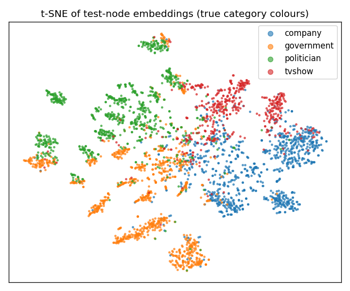
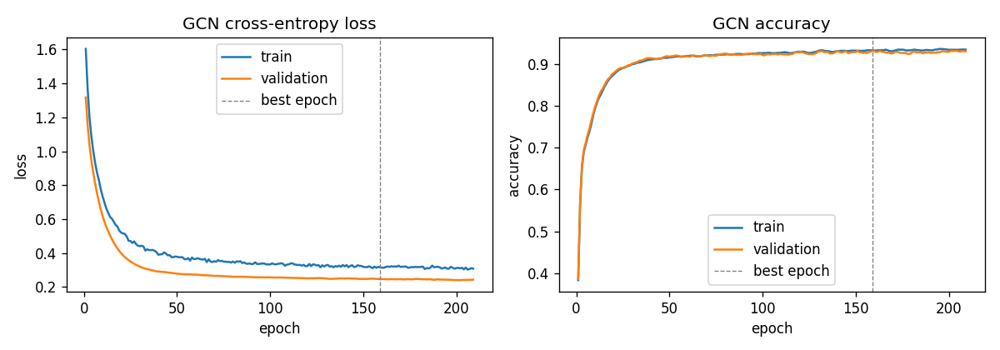
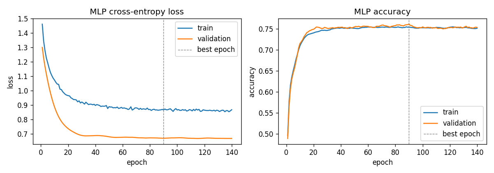
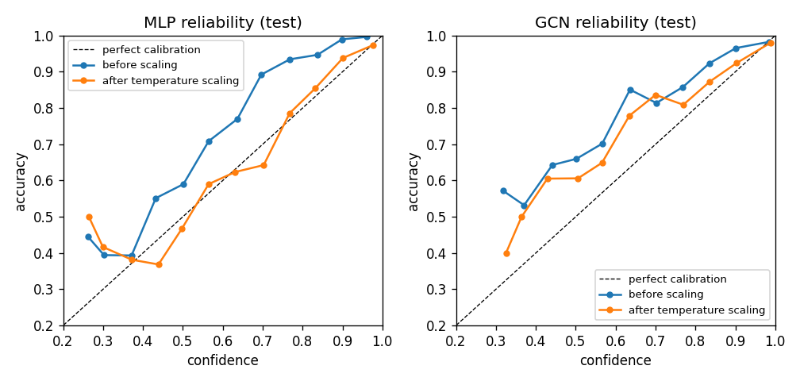
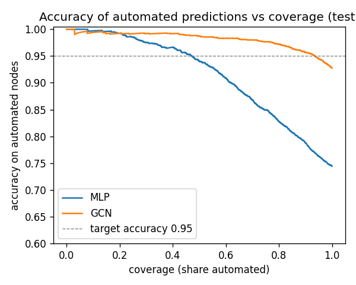

# GCN Node Classification on the Facebook Page-Page Network

**Author:** nthawanthaleunglit (s4922462) · COMP3710 Project 2.1 (Classification) · Multi-layer GNN, Normal difficulty



## Problem

The Facebook Large Page-Page Network [1] is a graph of 22,470 verified Facebook pages. Two pages are
linked when they like each other (170,823 undirected links). Each page has a 128-dimensional feature vector
built from its own description text. The task is **semi-supervised multi-class node classification**:
predict whether each page is a **company, government organisation, politician or TV show**.

The engineering question is not only "how accurate is it?" but the course's *confidence and ambiguity
dilemma*: can the model's confidence be trusted so that a reviewer only checks the pages the model is unsure
about? This project compares a two-layer **Graph Convolutional Network (GCN)** [2] against an **MLP baseline**
that sees exactly the same features but ignores the graph, and then builds a calibrated reject option on top of
both.

## How It Works

A GCN layer updates every page by mixing its own features with its neighbours' features:

$$H^{(l+1)} = \sigma\left(\hat{A}\, H^{(l)} W^{(l)}\right), \qquad \hat{A} = D^{-1/2}(A + I)\,D^{-1/2}$$

`A + I` is the adjacency matrix with a self loop on every page, so a page keeps its own information. `D` is the
degree matrix of `A + I`, and the symmetric `D^{-1/2} … D^{-1/2}` scaling turns the sum over neighbours into a
degree-weighted average, so pages with thousands of links do not get huge activations. `W` is a learned weight
matrix shared by all pages. One layer lets information travel one hop; two layers let each page see its
neighbours' neighbours.

The model is `dropout → GCNLayer(128→64) → ReLU → dropout → GCNLayer(64→4)`, followed by softmax over the four
categories. `Â` is stored as a sparse matrix (about 364k non-zeros instead of 505 million entries), so one
forward pass over the whole graph is a single sparse matrix product per layer.

The MLP baseline is the same network with `Â` replaced by the identity: `dropout → Linear(128→64) → ReLU →
dropout → Linear(64→4)`. Both models have exactly **8,516 parameters**, so any difference comes from using
the graph, not from model size.

Why the graph should help: 88.5% of links join two pages of the same category (edge homophily 0.885), so a
page's neighbours are strong evidence for its own label.

## Feasibility Review

The one-page feasibility review below was presented to my tutor at the midpoint check-off (20/10/2026). My
primary plan in that review is ConvNeXt on ADNI (Hard). This GCN project is the **stepping stone and fallback**
named in section 4 of the review: it is the same Project 2.1 dilemma, and the calibration and reject-option code
in `evaluate.py` is written to be reused unchanged for ConvNeXt.

<details>
<summary><b>Feasibility Review: ConvNeXt for Alzheimer's Triage on ADNI</b> (click to expand)</summary>

**1. User Need, Scope & Acceptance Criteria.**
Intended user: a neuroimaging reviewer screening T1-weighted brain MRI slices for Alzheimer's disease (AD)
versus cognitively normal (CN). Prototype purpose: a slice classifier that automates only high-confidence cases
and routes uncertain ones to a specialist. A missed AD case costs more than a false alarm.

| | Acceptance criterion (held-out ADNI test split) |
|---|---|
| AC1 | Slice-level test accuracy ≥ 0.80, with per-class precision, recall, macro-F1 and AUROC |
| AC2 | ECE ≤ 0.05 after temperature scaling on validation, with reliability diagrams for ConvNeXt and baseline |
| AC3 | Reject option keeping accuracy on auto-decided slices ≥ 0.95 while referring ≤ 30% of slices, AD recall ≥ 0.90 |
| AC4 | Zero patient IDs shared between train, validation and test (asserted in `dataset.py`) |
| AC5 | Peak VRAM ≤ 16 GB at batch 32, training ≤ 2 GPU-hours on one A100, inference ≤ 10 ms per slice |

**2. Model Choice & Course Concepts.**
Data: preprocessed ADNI on Rangpur, 2D 256×240 slices, 20 per patient. Patient ID parsed from the file name
and used for a patient-level 85/15 train/validation split; the provided test set is untouched. Model: a reduced
ConvNeXt [3] (patchify stem, 7×7 depthwise convolutions, inverted bottleneck, LayerNorm, GELU, stochastic depth)
trained from scratch. Baseline: a plain 4-block CNN on identical splits. Course concepts: receptive fields,
batch vs layer normalisation, regularisation, AdamW with cosine schedule, calibration, patient-level
generalisation.

**3. Preliminary Feasibility Evidence** (data audit and a 1-epoch smoke test on a Rangpur A100, batch 32).

| Split | AD patients / slices | NC patients / slices |
|---|---|---|
| Train (85%) | 442 / 8,840 | 473 / 9,460 |
| Validation (15%) | 78 / 1,560 | 83 / 1,660 |
| Test (provided) | 223 / 4,460 | 227 / 4,540 |

| Smoke test (1 epoch) | Params | Peak VRAM | Time / epoch | Val accuracy |
|---|---|---|---|---|
| Baseline CNN | 0.39 M | 1.05 GB | 17.4 s | 0.484 |
| Reduced ConvNeXt | 4.83 M | 1.22 GB | 24.9 s | 0.639 |

Zero patient overlap across splits (AC4 met); classes balanced (≈ 48% AD); 100 epochs ≈ 45 min, so AC5 is
feasible.

**4. Risks, Budget & Fallback.**
Risks: overfitting / not reaching 0.80 (reduced width, augmentation, stochastic depth, early stopping); hidden
leakage (patient-ID split with assertion); overconfidence (temperature scaling, reliability diagrams); queue time.
Budget ≈ 6 GPU-hours. **Fallback:** if ConvNeXt is below 0.80 by 28 Oct, submit a multi-layer GNN on the
Facebook Page-Page network (Normal difficulty, same dilemma), built first as a stepping stone — this folder.

</details>

## Dependencies

Tested on macOS (Apple silicon, CPU only) with:

| Package | Version |
|---|---|
| Python | 3.9.6 |
| torch | 2.8.0 |
| numpy | 2.0.2 |
| matplotlib | 3.9.4 |
| scikit-learn | 1.6.1 |

```bash
pip install -r requirements.txt
```

No PyTorch Geometric is needed: the GCN layer and sparse adjacency are written in plain PyTorch, and the
dataset is downloaded directly as `facebook.npz`. A CUDA GPU is used automatically if available.

**Reproducibility.** The data split and weight initialisation are seeded (`--seed 624`). Re-running on the
same machine reproduces the numbers below; on a different CPU/GPU, sparse matrix products can differ in the last
floating-point digits, so expect results within about ±0.5% accuracy.

## Data and Splits

- **Source:** the course-linked `facebook.npz` from gayanku/facebook_page-page_dataset (the same file PyTorch
  Geometric's `FacebookPagePage` uses), downloaded by `dataset.py` into `data/` on first run. It contains `X`
  (22470×128 features), `edges_x`/`edges_y` (directed edge list), `y` (labels) and `page_name`.
- **Label order:** the dataset's README lists the labels as 0 tvshow, 1 government, 2 company, 3 politician,
  but the page names contradict it (label 0 holds pages like "Nescafé Dolce Gusto", label 2 holds pages like
  "Damien O'Connor MP"). The real order is alphabetical, as in the original MUSAE release [1]:
  **0 company (6,495), 1 government (6,880), 2 politician (5,768), 3 tvshow (3,327)**.
- **Setting: transductive.** All 22,470 pages and all links are present during message passing (the graph
  is one connected social network, and at prediction time a new page's links are known). Only *training*
  labels enter the loss. Validation and test labels are never used for training, early stopping uses only
  validation, and test labels are only read in `evaluate.py` and `predict.py`.
- **Split: 70 / 15 / 15 stratified by class** (15,729 / 3,370 / 3,371 pages), so the minority class (TV
  show, 14.8%) has the same share in every split. 70% gives the model plenty of labelled neighbours; 15% for
  validation is enough (≈ 500 TV shows) for stable early stopping and for fitting the temperature and threshold;
  the 15% test set is used once for final numbers. The split is asserted to be disjoint.
- **Pre-processing:** features are standardised (zero mean, unit variance per dimension) using statistics from
  **training pages only**, so no information from validation or test features leaks into the scaling. Self
  loops in the raw edge list are dropped and then added back exactly once in `Â`.

```text
$ python dataset.py
Nodes: 22470  Directed edges: 341646 (170823 undirected)  Features: 128
Split    Nodes     company  government  politician      tvshow
train    15729        4546        4816        4038        2329
val       3370         974        1032         865         499
test      3371         975        1032         865         499
Edge homophily (share of edges joining same-class pages): 0.885
```

## Training

Full-batch training: each epoch is one forward pass over the whole graph, with cross-entropy on training pages
only. Adam (lr 0.01, weight decay 5e-4), dropout 0.5, hidden size 64, up to 500 epochs with **early stopping**
(patience 50) on validation accuracy; the weights from the best validation epoch are restored and saved.

| GCN training curves | MLP training curves |
|---|---|
|  |  |

Neither model overfits: train and validation curves stay close together. (Training loss sits above validation
loss because it is measured with dropout active.) The MLP levels off at about 0.75 accuracy after 20–30 epochs
and early stopping picks epoch 90: the page features alone cannot separate the categories any further, so the
limit is information, not training time. The GCN climbs to about 0.93 and keeps improving slowly until epoch 159.

## Results

All numbers are on the same 3,371 held-out test pages.

| Metric | MLP (baseline) | GCN |
|---|---|---|
| Accuracy | 0.745 | **0.928** |
| Macro-F1 | 0.717 | **0.923** |
| AUROC (one-vs-rest, macro) | 0.926 | **0.987** |

Per-class results:

| Class (test pages) | MLP precision | MLP recall | MLP F1 | GCN precision | GCN recall | GCN F1 |
|---|---|---|---|---|---|---|
| company (975) | 0.820 | 0.799 | 0.809 | 0.931 | 0.931 | 0.931 |
| government (1,032) | 0.649 | 0.891 | 0.751 | 0.915 | 0.953 | 0.934 |
| politician (865) | 0.809 | 0.689 | 0.744 | 0.945 | 0.929 | 0.937 |
| tvshow (499) | 0.808 | 0.431 | 0.562 | 0.917 | 0.864 | 0.890 |

The largest gain is on **TV shows**, the smallest class: the MLP finds fewer than half of them (recall 0.431),
the GCN finds 86%. The MLP also over-predicts government (precision 0.649), using it as a default for unclear
pages.

**Embedding plot.** The t-SNE at the top of this README shows the GCN's 64-dimensional hidden representation of
the test pages, coloured by true category. Politicians (green) and government (orange) form many small tight
clusters, which suggests separate communities in the like graph (for example, pages from one country liking each
other).
Companies (blue) and TV shows (red) form two large regions on the right with a mixed border between them; this
is where most errors live (media companies vs the shows they broadcast). Government and politician clusters
also touch, which matches the most confident error below.

**Resource profile** (Mac CPU; peak GPU VRAM not measured because this model was trained on CPU):

| | MLP | GCN |
|---|---|---|
| Parameters | 8,516 | 8,516 |
| Best epoch / training time | 90 / 1.6 s | 159 / 8.2 s |
| Inference, whole graph (22,470 pages) | 0.6 ms | 9.2 ms |
| Peak GPU VRAM | n/a (CPU) | n/a (CPU) |

The GCN costs roughly 15× the inference time of the MLP because of the sparse product with `Â`, but both are far
below any practical limit: classifying every page in the network takes under 10 ms.

## Investigation of the Open Research Dilemma

### 1. Is confidence calibrated?

Expected calibration error (ECE, 15 bins) measures the gap between confidence and actual accuracy. Temperature
scaling [4] divides the logits by one scalar `T`, fitted on the **validation** set by minimising
negative log-likelihood; `T < 1` sharpens the probabilities, `T > 1` softens them.

| | MLP | GCN |
|---|---|---|
| Fitted temperature T | 0.60 | 0.79 |
| ECE before scaling | 0.105 | 0.047 |
| ECE after scaling | 0.026 | 0.027 |



Both models are **under-confident on average**, not over-confident: the blue curves lie *above* the diagonal
(e.g. MLP predictions with about 0.7 confidence are right 89% of the time, GCN predictions with about 0.63
confidence are right 85% of the time) and both fitted temperatures are below 1.
Dropout 0.5 and weight decay make the softmax outputs soft. Temperature scaling fixes this well for both.

But the average hides a problem. Counting test pages that are **wrong with confidence ≥ 0.9**:

| | Errors | Errors with confidence ≥ 0.9 | Mean confidence when right | Mean confidence when wrong |
|---|---|---|---|---|
| MLP | 861 | 1 | 0.70 | 0.47 |
| GCN | 244 | **39** | 0.90 | 0.66 |

The GCN makes 3.5× fewer errors, but **16% of its errors are confidently wrong**, against 0.1% for the MLP. The
MLP's errors are easy to catch because it is unsure about them; a group of the GCN's errors look exactly like its
correct predictions. Temperature scaling (T = 0.79) makes these worse, because it sharpens every prediction.

### 2. Where does the GCN fail? (failure-case autopsy)

Test accuracy split by **local homophily**, the share of a page's neighbours that have the page's own label:

| Share of same-class neighbours | Test pages | MLP accuracy | GCN accuracy |
|---|---|---|---|
| < 0.5 (mostly other-class neighbours) | 177 | 0.463 | **0.373** |
| 0.5 – 0.8 | 477 | 0.658 | 0.887 |
| ≥ 0.8 | 2,717 | 0.778 | 0.971 |

The GCN beats the MLP everywhere **except** on heterophilous pages, where it is worse than the baseline. The
five most confident GCN errors (`python predict.py --model gcn`) all fit this pattern:

| Page | True | Predicted | Confidence | Degree | Neighbour labels | Diagnosis |
|---|---|---|---|---|---|---|
| European Committee of the Regions | government | politician | 1.00 | 157 | 77% politician | An EU body whose page is liked mainly by the politicians who sit on it |
| Senado de la República | government | politician | 1.00 | 35 | 91% politician | A senate liked by its own senators: averaging their pages overwhelms its own features |
| Cámara de Diputados – H. Congreso | government | politician | 1.00 | 48 | 83% politician | Same pattern for a chamber of deputies |
| DIRECTV Puerto Rico | company | tvshow | 1.00 | 69 | 81% tvshow | Pay-TV provider surrounded by its channels' pages |
| ITV Football | company | tvshow | 1.00 | 8 | 100% tvshow | Sports-broadcast brand page linked only to TV shows; arguably an ambiguous label |

**Root cause:** the GCN assumes neighbours share labels. When a page's neighbourhood is dominated by another
class, message passing pushes it confidently into that class, and the softmax has no way to say "my neighbours
disagree with my own features". The failures fall into two groups: **legislatures** (government pages liked
mostly by their own members, who are politicians) and **media companies** (company pages surrounded by the TV
shows they broadcast). These are the two places where the t-SNE regions touch. Low degree adds risk: pages with
1–2 links have GCN accuracy 0.878, against 0.954 for pages with 10+ links, because a few neighbours decide
everything.

For comparison, the MLP's most confident errors are different in kind: *Nextdoor* (0.94), *Extreme Tornado
Tours* and *OLD BAY® Seasoning* are companies predicted as government. These are feature-level confusions: the
MLP uses government as a default for pages whose descriptions do not look clearly commercial, and its confidence
on them stays at or below 0.94.

### 3. Reject option: automate confident pages, refer the rest

On the **validation** set, after temperature scaling, I choose the lowest confidence threshold at which the
automated pages still reach **95% accuracy**. Pages below the threshold go to a human reviewer. The threshold is
then applied unchanged to the test set.

| Test set | MLP | GCN |
|---|---|---|
| Threshold (calibrated confidence) | 0.795 | 0.557 |
| Coverage (share automated) | 48.3% | **94.7%** |
| Accuracy on automated pages | 0.946 | 0.946 |
| Accuracy on referred pages | 0.557 | 0.593 |



To reach about 95% accuracy the MLP has to refer more than half of all pages to a human; the GCN refers about
5%. For both models the test accuracy on automated pages (0.946) is slightly below the 0.95 target set on
validation, so the threshold should be set with a small safety margin (for the GCN, 93.5% coverage still reaches
0.95 on test, see the curve).

### 4. Recommendation to the project manager

1. **Use the GCN, not the MLP.** At the same parameter count and about 10 ms per full-graph pass, it cuts the
   human review workload from 52% of pages to about 5–7% at roughly 95% accuracy. The extra cost is negligible.
2. **Do not trust confidence alone.** The GCN's remaining errors are concentrated on pages whose neighbours
   mostly belong to another class, and on these it is confidently wrong (39 errors at ≥ 0.9 confidence). A
   confidence threshold cannot catch them.
3. **Add a second, graph-aware rule:** also refer a page to a human if (a) fewer than half of its neighbours
   (using known labels, or predicted labels where unknown) are in the class predicted for the page, i.e. low
   local homophily; (b) it has fewer than 3 links; or (c) the GCN and the MLP disagree. These rules target the
   failure cases above and are cheap to compute. They are a proposal and have not been tested in this project.
4. **Watch legislatures and media companies.** Both boundaries are partly a labelling question (is a senate a
   government body or a group of politicians? is a TV channel a company?). Clarify the labelling guideline
   before deployment, since no model can learn a rule the labels do not follow.

## Usage

Run from this folder. The dataset is downloaded automatically on the first run.

```bash
python dataset.py                 # download data, print split sizes and homophily
python train.py --model mlp       # train baseline -> outputs/mlp.pt, mlp_summary.json, mlp_curves.png
python train.py --model gcn       # train GCN      -> outputs/gcn.pt, gcn_summary.json, gcn_curves.png
python evaluate.py                # metrics, calibration, reject option -> evaluation.json, reliability.png, risk_coverage.png
python predict.py --model gcn     # example predictions, confident errors, t-SNE -> gcn_tsne.png
```

`train.py --help` lists all hyper-parameters (`--hidden`, `--layers`, `--dropout`, `--lr`, `--weight-decay`,
`--epochs`, `--patience`, `--seed`). Trained weights (`*.pt`) and the dataset are not committed.

Example output of `predict.py --model gcn`:

```text
GCN test accuracy: 0.9276 on 3371 pages

Example predictions:
  [ok ] Socialstyrelsen                          true=government  pred=government  conf=0.95
  [ok ] 1st Armored Division Sustainment Brigade true=government  pred=government  conf=1.00
  [ok ] Hydro Coco                               true=company     pred=company     conf=0.98
  [ok ] Sunrun                                   true=company     pred=company     conf=0.87
  [ok ] St. Cloud VA Health Care System          true=government  pred=government  conf=0.99

Most confident errors (244 errors in total):
  European Committee of the Regions      true=government  pred=politician  conf=1.00 degree=157  neighbours: gove 23%, poli 77%
  Senado de la República                 true=government  pred=politician  conf=1.00 degree=35   neighbours: gove 9%, poli 91%
```

The same pages under the MLP: *Socialstyrelsen* (the Swedish health agency) is predicted politician with 0.81
confidence, and the Korean TV show *식샤를합시다* is predicted government with 0.41. Both are wrong; the second
has low confidence, so the reject option would refer it, but the first is confident enough to be automated.

### Files

| File | Contents |
|---|---|
| `dataset.py` | Download, stratified split, training-only standardisation, sparse `Â`, `GraphData` container |
| `modules.py` | `MLP`, `GCNLayer`, `GCN`, `build_model` (pure PyTorch) |
| `train.py` | Full-batch training with early stopping, saves weights, summary and loss/accuracy curves |
| `evaluate.py` | Per-class metrics, AUROC, ECE, temperature scaling, risk–coverage and reject-option threshold |
| `predict.py` | Loads saved weights, prints example predictions and confident errors with neighbour mix, t-SNE plot |
| `outputs/` | Figures and JSON results shown in this README |

## Artificial Intelligence Usage Disclosure

- **Tool:** Claude (Anthropic), through Claude Code.
- **What it helped with:** reading the task sheet and choosing a project; drafting the feasibility review and
  the Rangpur smoke-test script; scaffolding the five Python files in small steps (one commit per component);
  writing the evaluation functions (ECE, temperature scaling, risk–coverage); producing a line-by-line
  walkthrough of the code; and drafting this README from the measured results.
- **How I verified it:**
  - I read every file line by line with the walkthrough and worked through the GCN formula by hand on a 5-node
    toy graph before pushing anything.
  - I rewrote parts of the code myself (for example, `GraphData` changed from a `@dataclass` with a `@property`
    to a plain `__init__`, and docstrings were replaced by my own comments).
  - The label order taken from the dataset README turned out to be wrong; it was caught by printing page names
    and class counts for each label and fixed in its own commit.
  - A bug in the first MLP draft (`x.relu() if False else x`, which silently skipped the activation) was caught
    in review before it was committed.
  - Leakage checks are executable: the split masks are asserted disjoint, and feature scaling uses training
    pages only.
  - Every number in this README comes from the saved `outputs/*.json` files or from running the scripts.

## References

1. B. Rozemberczki, C. Allen, and R. Sarkar, "Multi-scale attributed node embedding," *Journal of Complex
   Networks*, vol. 9, no. 2, 2021.
2. T. N. Kipf and M. Welling, "Semi-supervised classification with graph convolutional networks," in
   *Proc. ICLR*, 2017.
3. Z. Liu, H. Mao, C.-Y. Wu, C. Feichtenhofer, T. Darrell, and S. Xie, "A ConvNet for the 2020s," in
   *Proc. CVPR*, 2022.
4. C. Guo, G. Pleiss, Y. Sun, and K. Q. Weinberger, "On calibration of modern neural networks," in
   *Proc. ICML*, 2017.
